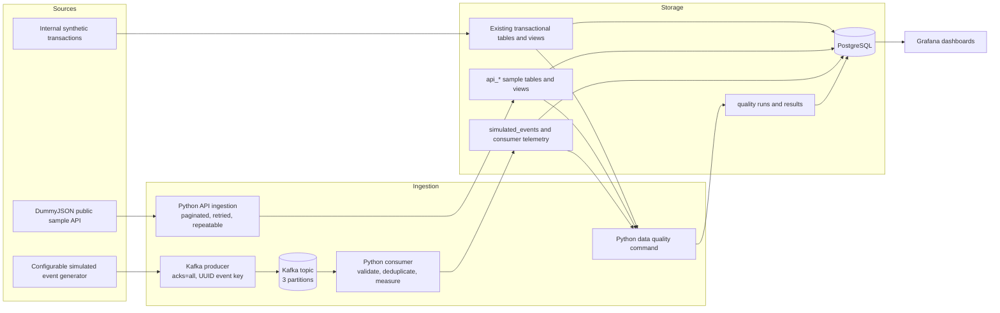

# Real-Time E-Commerce Intelligence Platform

A local, production-style data engineering demonstration that combines an existing synthetic transactional dataset, externally sourced DummyJSON sample records, and a Kafka stream of explicitly simulated events. PostgreSQL is the shared analytical store and Grafana is the observability layer. The platform keeps source boundaries visible so demonstration data is not mistaken for real customer or sales activity.

## Architecture



### Data boundaries

- **Internal synthetic:** pre-existing `customers`, `products`, `orders`, `order_items`, `payments`, inventory, shipments, `user_events`, and `system_events`. These records are illustrative.
- **External sample:** products, users, and carts fetched from DummyJSON into separate `api_*` tables. They are not this platform's actual catalog, users, or sales.
- **Simulated streaming:** generated Kafka events with `source_system='simulated'`, written to `simulated_events`. These are not real user activity or an order ledger.

The five operational dashboards and the added Data Quality dashboard label their sources. The existing database records and services are preserved; new ingestion, stream telemetry, and quality structures are additive.

## Components

| Component | Purpose |
|---|---|
| PostgreSQL 16 | Transactional sample data, API staging, simulated stream sink, run history, and quality results |
| Kafka 3.9.1 | Local broker for the simulated event demonstration |
| Python virtual environment | API client/loaders, event producer/consumer, and quality runner |
| Grafana 11.5.2 | Six provisioned dashboards backed by PostgreSQL |

## Setup

Use the project interpreter directly; the commands below do not require the Windows Store launcher or a global Python installation.

1. Copy `.env.example` to `.env` and enter the local PostgreSQL credentials. Keep `.env` private; `.gitignore` excludes it. The sample file contains placeholders only.
2. Install dependencies into the existing project environment:

   ```powershell
   & .\.venv\Scripts\python.exe -m pip install -r .\ingestion\requirements.txt
   ```

3. Start the project services and inspect their health:

   ```powershell
   docker compose up -d
   docker compose ps
   ```

   PostgreSQL is available at `localhost:5432`, Kafka at `localhost:29092`, and Grafana at `http://localhost:3000` (user `admin`). Set a private `GRAFANA_ADMIN_PASSWORD` in `.env` before starting Grafana; the compose file has no public default credential. Replace the placeholder in `.env.example` before use.

## Repeatable API ingestion

Run all DummyJSON endpoints, or select one endpoint. The command is safe to repeat: records are upserted by their source ID, and each endpoint execution is recorded in `api_ingestion_runs`.

```powershell
& .\.venv\Scripts\python.exe -m ingestion.src.main
& .\.venv\Scripts\python.exe -m ingestion.src.main --endpoint products
& .\.venv\Scripts\python.exe -m ingestion.src.main --endpoint users
& .\.venv\Scripts\python.exe -m ingestion.src.main --endpoint carts
```

The run history stores entity, start/end time, status, extracted count, loaded count, and error text. HTTP requests use timeouts and retry transient connection errors and HTTP 429/5xx responses with backoff. Failures are logged to `ingestion/logs/pipeline.log`, set the run to `failed`, and return a non-zero process exit for Task Scheduler to record. No secrets are written to run history.

### Schedule on Windows

Use **Task Scheduler → Create Task**. For a daily API load, set the action to:

- **Program/script:** `C:\realtime-intelligence-platform\.venv\Scripts\python.exe`
- **Add arguments:** `-m ingestion.src.main`
- **Start in:** `C:\realtime-intelligence-platform`

Choose an appropriate daily trigger and enable task history. Create a second task using `-m ingestion.src.quality` if quality checks should run after ingestion; use an “At task completion” trigger or schedule it a few minutes later. The task account must be able to read `.env` and write the project log. Task Scheduler history and the local log provide practical failure notification without introducing another service. Use **Run** in Task Scheduler to verify the configured action.

## Real-time demonstration

Open two PowerShell terminals from the project folder. Start the consumer first, then start the continuous producer:

```powershell
# Terminal 1: consume indefinitely; Ctrl+C requests a graceful stop.
& .\.venv\Scripts\python.exe -m ingestion.src.streaming consume

# Terminal 2: produce continuously at the configured rate; Ctrl+C requests a graceful stop.
& .\.venv\Scripts\python.exe -m ingestion.src.streaming produce
```

`EVENT_RATE_PER_MINUTE` in `.env` configures the default rate (30 events/minute). Override it per run with `--rate`; omit `--count` for continuous generation. Finite runs are useful for bounded demonstrations:

```powershell
& .\.venv\Scripts\python.exe -m ingestion.src.streaming produce --count 20 --rate 60
& .\.venv\Scripts\python.exe -m ingestion.src.streaming consume --max-events 20
```

Each event has a UUID, timezone-aware timestamp, supported event type, internal sample references where available, and a payload marked simulated. The producer uses Kafka acknowledgements and retries. The consumer validates each message, writes the batch and its telemetry transactionally, and commits Kafka offsets only after PostgreSQL commits. `event_id` is the PostgreSQL primary key; conflict-safe inserts suppress replay duplicates. Consumer groups can replay the topic for demonstrations without adding duplicate event rows.

`streaming_consumer_batches` records received/valid/inserted/duplicate/failed counts, batch processing milliseconds, and status. `streaming_consumer_errors` records invalid events or database persistence failures. `simulated_events.processing_latency_ms` measures event timestamp to database persistence. The Data Engineering dashboard shows persisted events per minute, counts by type, both latency measures, errors, failed batches, and suppressed duplicates.

## Data quality

Run the checks on demand:

```powershell
& .\.venv\Scripts\python.exe -m ingestion.src.quality
& .\.venv\Scripts\python.exe -m ingestion.src.quality --stale-after-hours 24
```

Each run is saved in `data_quality_runs`, with one `data_quality_results` row per rule. Checks cover critical null fields, duplicate IDs, invalid prices, negative quantities, allowed payment statuses, invalid/future timestamps, missing relationships, and stale or missing DummyJSON ingestion. Integrity findings fail the command; stale external sample data is a warning. Checks are read-only against source data.

## Grafana dashboards

The dashboards use a default 30-day range and provisioned PostgreSQL datasource. Use the dashboard time picker to select a narrower or wider interval.

| Dashboard | Focus | Screenshot |
|---|---|---|
| Executive Overview | Synthetic revenue and order activity | [Open screenshot](docs/screenshots/exec-overview.png) |
| Customer Activity | Synthetic sessions, page views, devices, and countries | [Open screenshot](docs/screenshots/customer-activity.png) |
| Payment Monitoring | Synthetic payment outcomes, methods, and failures | [Open screenshot](docs/screenshots/payment-monitoring.png) |
| Inventory and Shipping | Inventory, shipment status, and delays | [Open screenshot](docs/screenshots/inventory-shipping.png) |
| Data Engineering Monitoring | System events, DummyJSON run history, and Kafka telemetry | [Open screenshot](docs/screenshots/data-engineering.png) |
| Data Quality | Latest run, findings, and run trends | Provisioned in Grafana as `data-quality` |

Screenshots of the five original dashboards are stored under `docs/screenshots/`. They are static captures; open Grafana to see current values and select a different time range.

## Example SQL

```sql
-- Successful internal synthetic revenue by day (USD).
SELECT date_trunc('day', created_at) AS day, SUM(amount) AS revenue_usd
FROM payments
WHERE lower(payment_status) IN ('success', 'succeeded', 'completed')
GROUP BY 1 ORDER BY 1;

-- DummyJSON sample product counts are separate from internal products.
SELECT category, count(*) AS sample_products, round(avg(price), 2) AS mean_sample_price
FROM api_products GROUP BY category ORDER BY sample_products DESC;

-- Streaming throughput and measured consumer persistence latency.
SELECT date_trunc('minute', consumed_at) AS minute, count(*) AS persisted_events,
       round(avg(processing_latency_ms), 2) AS event_to_postgres_ms
FROM simulated_events GROUP BY 1 ORDER BY 1;

-- Most recent quality result summary.
SELECT q.run_id, q.started_at, q.status, q.checks_passed, q.checks_failed, q.checks_warned
FROM data_quality_runs q ORDER BY q.started_at DESC LIMIT 1;
```

## Technical challenges and solutions

- **Separating demonstration data:** source-specific tables, source columns, dashboard banners, and query labels keep synthetic, external sample, and simulated events distinguishable.
- **Repeatable ingestion:** paginated fetch validation, transient HTTP retries, source-key upserts, and per-endpoint run records make reruns safe and failures inspectable.
- **At-least-once Kafka delivery:** manual offset commits after PostgreSQL commit plus a UUID primary key make replays safe and visible in duplicate metrics.
- **Useful empty dashboards:** queries expose zero-valued stats or explicit “no errors/no delayed shipments” rows instead of ambiguous blank panels; units and time filters are explicit.
- **Data quality without mutating source data:** checks report counts in a separate run/results history and fail the command on integrity violations.

## Performance and reliability benchmark

Reproduce the measured Kafka batch sizes, five-minute stream, PostgreSQL baseline/analysis, and safe failure checks with the benchmark scripts:

```powershell
& .\.venv\Scripts\python.exe -m ingestion.benchmarks.postgres_benchmark --capture-baseline
& .\.venv\Scripts\python.exe -m ingestion.benchmarks.kafka_benchmark --sizes 100 1000 5000 --continuous-seconds 300 --continuous-rate 20
& .\.venv\Scripts\python.exe -m ingestion.benchmarks.postgres_benchmark --measure
& .\.venv\Scripts\python.exe -m ingestion.benchmarks.reliability_check
```

The benchmark scripts create tagged synthetic rows and uniquely named Kafka topics/groups. They do not delete benchmark evidence or stop shared services. See the [performance report](docs/PERFORMANCE_BENCHMARK.md), [reliability report](docs/RELIABILITY_TESTS.md), and [analysis SQL](docs/benchmark_queries.sql) for actual measurements and test limits.

## Project layout

```text
database/                 Additive staging, telemetry, quality DDL, and API views
grafana/dashboards/       Six generated, provisioned dashboard definitions
grafana/provisioning/     PostgreSQL datasource and dashboard provider
ingestion/src/            API client/loaders, stream producer/consumer, quality runner
ingestion/logs/           Local pipeline log output (ignored by Git)
docs/                     Architecture, data dictionary, benchmark reports, and screenshots
ingestion/benchmarks/     Reproducible Kafka, PostgreSQL, and reliability runners
tests/                    Unit tests
docker-compose.yml        PostgreSQL, Kafka, and Grafana services
```

## Validation

Run the test suite with the project interpreter:

```powershell
& .\.venv\Scripts\python.exe -m unittest discover -s tests -v
```

For an end-to-end check, run one finite producer batch, consume it with a new `--group-id`, inspect `simulated_events` and `streaming_consumer_batches`, then open **Data Engineering Monitoring** in Grafana. Use the quality command and **Data Quality** dashboard to verify the latest run.
