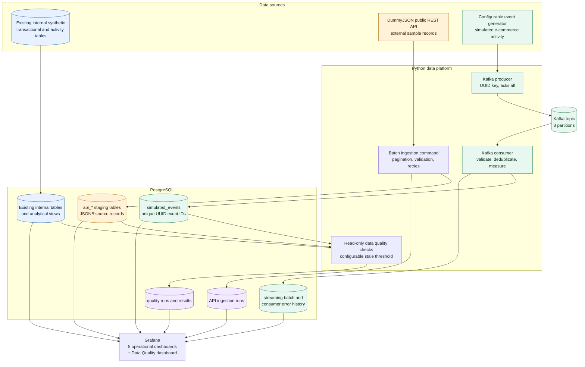

# Platform architecture

The platform keeps batch ingestion, the Kafka demonstration stream, quality checks, and existing internal sample data distinct while using PostgreSQL for durable analytical storage.

## Processing and delivery behavior

The API command retrieves paginated endpoints, validates IDs and pagination metadata, and retries transient HTTP errors. Loaders upsert on the DummyJSON source key and record a run per endpoint. The stream producer emits a configurable event rate. The consumer validates event structure, writes event rows and batch telemetry transactionally, and commits Kafka offsets only after PostgreSQL has committed. A PostgreSQL UUID primary key prevents replayed messages from creating duplicate event records. The quality command reads its source tables, writes one result for each check, and does not repair or update source records.

The system-event seed data, internal commerce tables, API sample tables, and generated Kafka records have separate labels and storage boundaries. None of the API samples or simulated events are presented as actual platform customers or orders.
